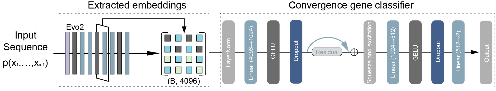

# DCGP
## Domestication Convergence Gene Prediction

DCGP is a sequence-based machine-learning framework for predicting genes under convergent selection during domestication across 44 plant species. Built upon the standardized comparative-genomic resource PhytoPop20K, DCGP enables cross-species inference of domestication convergence using sequence-encoded features alone, without requiring population-genetic statistics or allele-frequency contrasts. The model is trained using labeled convergence-selection genes curated in PhytoPop20K and sequence embeddings generated by Evo 2, which summarize nucleotide-level information into quantitative features suitable for machine learning. Once trained, DCGP can be applied to new genomes by simply passing gene sequences through the model, bypassing the need for population-level data, demographic modeling, or selection scans.

## Related Software and Tools

- [DNNGP](https://github.com/AIBreeding/DNNGP) – Deep neural network for genomic prediction.
- [EXGEP](https://github.com/AIBreeding/EXGEP) – A framework for predicting genotype-by-environment interactions using ensembles of explainable machine-learning models.
- [GxEtoolkit](https://github.com/AIBreeding/GxEtoolkit) – An automated and explainable machine learning framework for Genome Prediction.
- [BDP-identifier](https://github.com/AIBreeding/BDP-identifier) – Genomic Language Model-Based Prediction of Bidirectional Promoter Activity.
- [KANMB](https://github.com/AIBreeding/KANMB) –  A machine learning training and prediction tool based on KAN (Kolmogorov-Arnold Network) for identifying optimal metabolites from metabolite expression data.

## 🏁Table of Contents
- [Getting started](#Getting-started)
- [Usage](#Usage)

### Getting started

### Requirements

 - python 3.11
 - conda/pip

### Installation
The environment file targets Linux with an NVIDIA CUDA GPU. The FASTA
embedding step also uses SeqKit and the Evo 2 7B checkpoint.

```bash
git clone https://github.com/AIBreeding/DCGP.git
cd DCGP
conda env create -f environment.yml -n dcgp
conda activate dcgp
```

For Evo 2 installation details, see the [official Evo 2 repository](https://github.com/arcinstitute/evo2).

### Usage

Download the checkpoint for your model ID from the
[DCGP model repository](https://huggingface.co/AIBreeding/DCGP). For the example
below, run these commands from the code repository root:

```bash
MODEL_FILE=model/Brassica_napusA/Brassica_napusA.pt
hf download AIBreeding/DCGP "$MODEL_FILE" --local-dir .
awk -v path="$MODEL_FILE" '$2 == path' SHA256SUMS | shasum -a 256 -c
```

To reproduce a specific model release, add `--revision` with the full Hugging Face
commit SHA corresponding to the checkpoint.

#### 1. Use Evo2 to obtain sequence data embedding
```bash
python ./embedding.py \
        --fasta ./sequence/sample.fa \
        --step 250 \
        --window 1024 \
        --layer "blocks.24" \
        --save_txt ./sequence/embedding.txt \
        --out ./sequence/sa.pt
```
#### 2. Use the trained DCGP model for prediction
```bash
python ./predict.py \
        --data ./sequence/sa.pt \
        --model ./model/Brassica_napusA/Brassica_napusA.pt \
        --out ./results/pred \
        --batch_size 256
```

## 📜Copyright and License
The DCGP source code is licensed under the [PolyForm Noncommercial License 1.0.0](LICENSE).

The DCGP checkpoints are published under [CC BY-NC 4.0](https://creativecommons.org/licenses/by-nc/4.0/). See the [model card](https://huggingface.co/AIBreeding/DCGP) for the scope of the weight license.

## 👥Contacts
For more information, please contact with **Huihui Li** (lihuihui@caas.cn).
